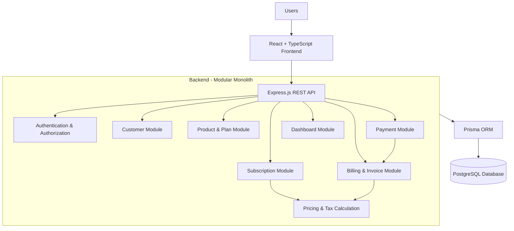
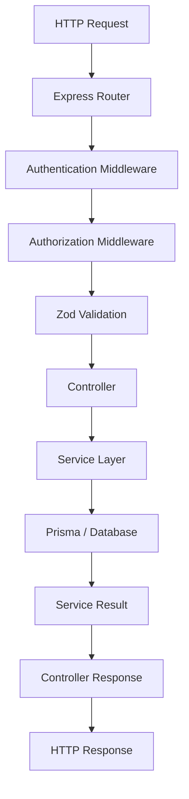
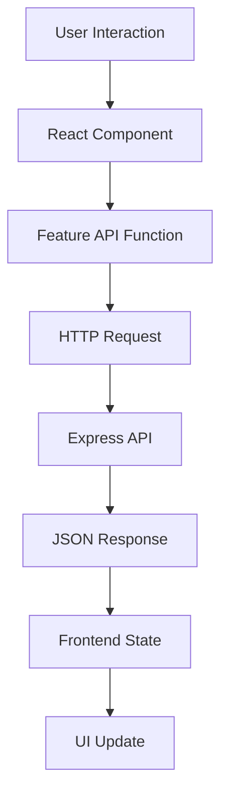
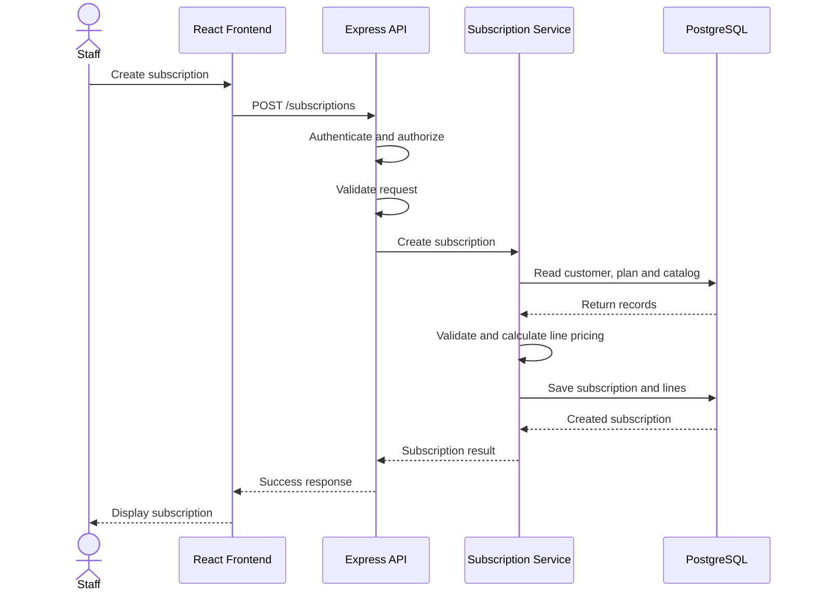
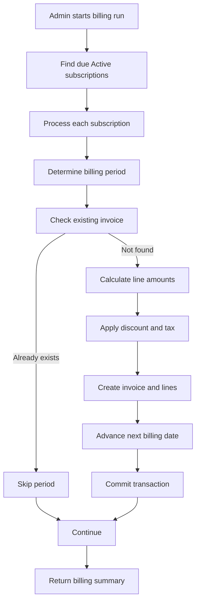
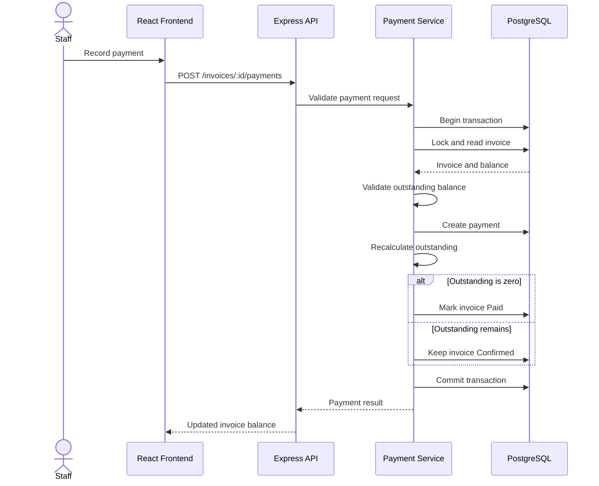
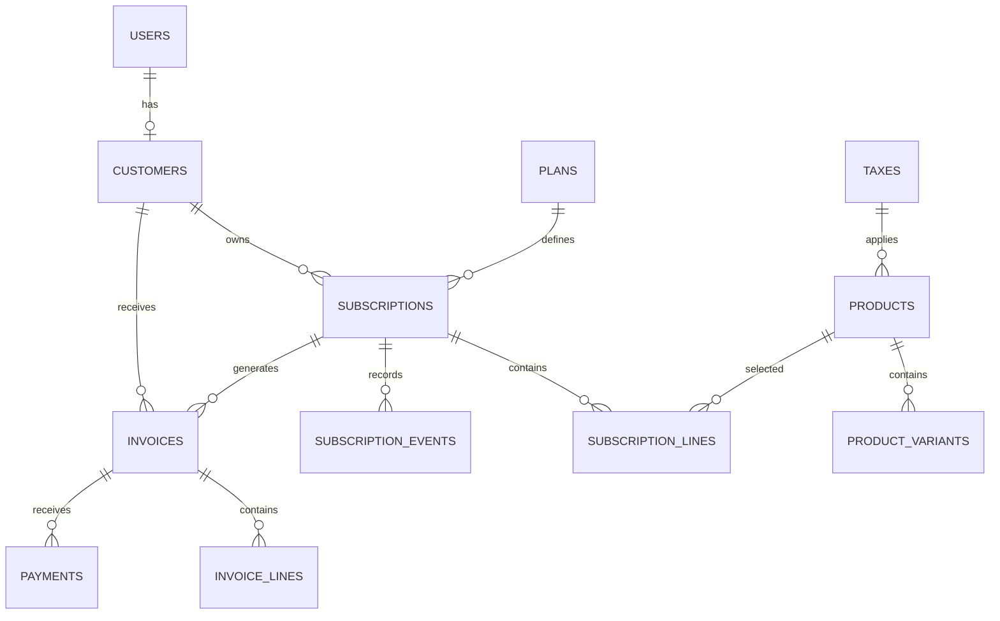
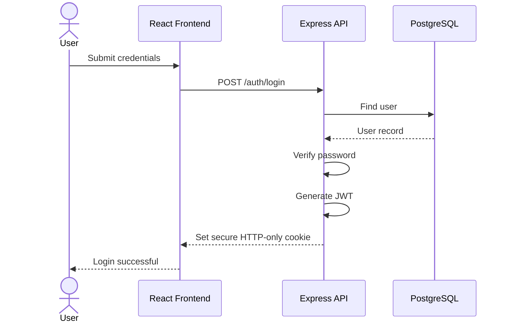
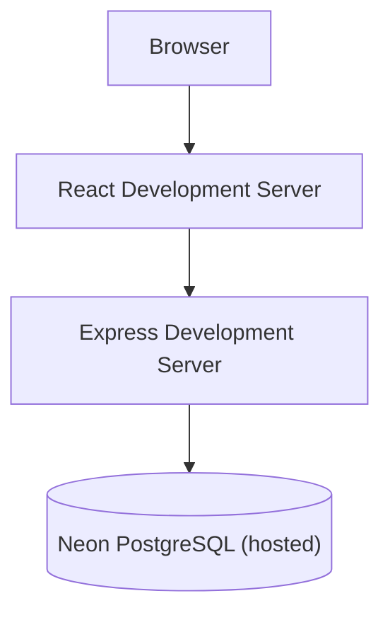
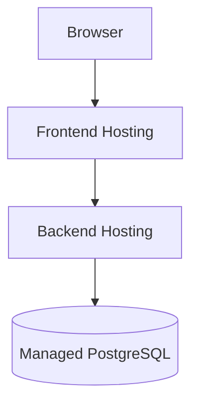

# Brightloop – System Architecture

**Document:** Architecture Specification  
**Project:** Brightloop Subscription Management System  
**Version:** 1.0  
**Status:** Proposed – MVP  
**Architecture Style:** Modular Monolith  
**Frontend:** React + TypeScript  
**Backend:** Express.js + TypeScript  
**Database:** PostgreSQL  
**ORM:** Prisma

---

# 1. Architecture Overview

## 1.1 Purpose

This document defines the technical architecture of the Brightloop Subscription Management System.

It describes the system components, their responsibilities, communication patterns, module boundaries, data flow and architectural constraints.

The architecture is designed to support the MVP requirements defined in `PRD.md`, with particular attention to subscription management, recurring invoice generation, payment recording, data consistency and role-based access control.

The initial implementation prioritizes simplicity, maintainability and correctness over distributed architecture.

## 1.2 Architectural Approach

Brightloop will use a **Modular Monolith Architecture**.

The frontend and backend will be separate applications, while the backend will contain logically separated business modules deployed as a single application.

Each module will own its business logic and expose clearly defined interfaces to other modules.

The application will use a centralized PostgreSQL database as its primary source of truth.

### Why a Modular Monolith?

- Simpler development and deployment compared with microservices.
- Easier database transactions across related business operations.
- Lower infrastructure and operational complexity.
- Clear separation of business responsibilities.
- Allows modules to evolve independently within the application.
- Suitable for the current MVP and small development team.

Microservices, distributed messaging and service discovery are not required for the MVP.

## 1.3 High-Level Architecture



### Component Responsibilities

| Component | Responsibility |
|---|---|
| React Frontend | User interface, forms, navigation and API communication |
| Express API | HTTP routing, request validation and response handling |
| Authentication | Login, logout, session validation and authorization |
| Customer Module | Customer profiles and customer-related operations |
| Product & Plan Module | Product catalog, variants, plans and taxes |
| Subscription Module | Subscription creation, pricing snapshots and lifecycle |
| Billing & Invoice Module | Billing periods, invoice creation and invoice lifecycle |
| Payment Module | Payment recording and outstanding balance calculation |
| Dashboard Module | Financial summaries and reporting queries |
| Prisma ORM | Database access and transaction management |
| PostgreSQL | Persistent application data and integrity constraints |

---

# 2. Technology Stack

| Layer | Technology | Purpose |
|---|---|---|
| Frontend | React | User interface |
| Language | TypeScript | Type safety |
| Styling | Tailwind CSS | UI styling |
| Backend | Express.js | REST API |
| Runtime | Node.js | Backend execution |
| Database | PostgreSQL | Primary data store |
| ORM | Prisma | Database access and migrations |
| Validation | Zod | Request and input validation |
| Authentication | JWT + HTTP-only cookies | User authentication |
| Password hashing | bcrypt or Argon2 | Secure password storage |
| API testing | Postman | Endpoint testing |
| Unit testing | Vitest | Business logic and service tests |
| Backend integration testing | Supertest | HTTP API tests |
| Frontend testing | React Testing Library | Component tests |
| E2E testing | Playwright | Complete user workflow testing |
| Containerization | Docker Compose | Local development environment |

### MVP Infrastructure Constraints

- PostgreSQL is the only required persistent database.
- Redis is not required initially.
- A separate message broker is not required initially.
- Billing can be initiated manually through an Admin API endpoint.
- Background workers and scheduled billing are future enhancements.
- The backend and frontend can be deployed independently.

---

# 3. Application Structure

The repository should use a simple monorepo structure.

```text
brightloop/
│
├── apps/
│   │
│   ├── backend/
│   │   ├── prisma/
│   │   │   ├── schema.prisma
│   │   │   ├── migrations/
│   │   │   └── seed.ts
│   │   │
│   │   ├── src/
│   │   │   ├── config/
│   │   │   │   ├── env.ts
│   │   │   │   └── database.ts
│   │   │   │
│   │   │   ├── middleware/
│   │   │   │   ├── authenticate.ts
│   │   │   │   ├── authorize.ts
│   │   │   │   ├── validate.ts
│   │   │   │   └── error-handler.ts
│   │   │   │
│   │   │   ├── modules/
│   │   │   │   ├── auth/
│   │   │   │   │   ├── auth.routes.ts
│   │   │   │   │   ├── auth.controller.ts
│   │   │   │   │   ├── auth.service.ts
│   │   │   │   │   └── auth.schema.ts
│   │   │   │   │
│   │   │   │   ├── users/
│   │   │   │   ├── customers/
│   │   │   │   ├── products/
│   │   │   │   ├── plans/
│   │   │   │   ├── taxes/
│   │   │   │   ├── discounts/
│   │   │   │   ├── subscriptions/
│   │   │   │   ├── billing/
│   │   │   │   ├── invoices/
│   │   │   │   ├── payments/
│   │   │   │   └── dashboard/
│   │   │   │
│   │   │   ├── shared/
│   │   │   │   ├── errors/
│   │   │   │   ├── types/
│   │   │   │   ├── utils/
│   │   │   │   └── constants/
│   │   │   │
│   │   │   ├── app.ts
│   │   │   └── server.ts
│   │   │
│   │   ├── tests/
│   │   ├── package.json
│   │   └── tsconfig.json
│   │
│   └── frontend/
│       ├── src/
│       │   ├── api/
│       │   ├── assets/
│       │   ├── components/
│       │   │   ├── common/
│       │   │   ├── forms/
│       │   │   └── layout/
│       │   │
│       │   ├── features/
│       │   │   ├── auth/
│       │   │   ├── dashboard/
│       │   │   ├── customers/
│       │   │   ├── products/
│       │   │   ├── plans/
│       │   │   ├── subscriptions/
│       │   │   ├── invoices/
│       │   │   ├── payments/
│       │   │   └── portal/
│       │   │
│       │   ├── hooks/
│       │   ├── routes/
│       │   ├── types/
│       │   ├── utils/
│       │   ├── App.tsx
│       │   └── main.tsx
│       │
│       ├── package.json
│       └── tsconfig.json
│
├── docs/
│   ├── PRD.md
│   ├── ARCHITECTURE.md
│   ├── DATABASE.md
│   ├── BUSINESS_RULES.md
│   ├── API_SPEC.md
│   └── TESTING_STRATEGY.md
│
├── docker-compose.yml
├── package.json
├── .env.example
├── .gitignore
└── README.md
```

### 3.1 Backend Module Structure

Each backend module should contain only the files required for its responsibilities.

| Layer | Responsibility |
|---|---|
| Routes | Define HTTP endpoints and middleware |
| Controller | Handle HTTP requests and responses |
| Service | Implement business logic and coordinate operations |
| Schema | Validate request data using Zod |
| Data access | Perform database queries through Prisma |

For the MVP, data-access functions can live inside the service or a small repository file. Do not introduce a repository abstraction for every simple CRUD operation without a practical reason.

### 3.2 Request Processing Flow



Responsibilities:

1. The router matches the incoming request.
2. Authentication middleware validates the user's identity.
3. Authorization middleware checks permissions.
4. Zod validates request parameters and body.
5. The controller calls the relevant service.
6. The service executes business operations.
7. Prisma interacts with PostgreSQL.
8. The controller returns a consistent API response.

Controllers must remain thin. Business rules must not be implemented directly inside route handlers.

---

# 4. Backend Module Responsibilities

## 4.1 Authentication and Users

**Responsibilities:**

- Customer registration.
- User login and logout.
- Password hashing and verification.
- JWT creation and validation.
- Role-based access control.
- Admin-created Internal Staff accounts.

**Dependencies:**

- Users module.
- Customers module.

Authentication identifies the user. Authorization determines what that user is allowed to do.

## 4.2 Customers Module

**Responsibilities:**

- Customer profile creation.
- Customer profile retrieval and updates.
- Customer listing for Admin and Staff.
- Customer-specific data access.

A Customer record is associated with a User account.

The customer portal must derive the customer ID from the authenticated user rather than trusting a customer ID supplied by the browser.

## 4.3 Products and Plans Module

**Responsibilities:**

- Product CRUD.
- Product variant management.
- Plan CRUD.
- Billing interval configuration.
- Tax configuration.
- Product and plan availability.

This module manages the catalog and configuration used by subscriptions.

It must not directly modify existing invoice records when a product, variant or tax is updated.

## 4.4 Subscriptions Module

**Responsibilities:**

- Subscription creation.
- Subscription line management.
- Price snapshot creation.
- Subscription lifecycle transitions.
- Next billing date management.
- Subscription history.

The subscription module owns subscription state and subscription-related business rules.

It uses catalog data when creating a subscription but stores the agreed pricing information separately.

## 4.5 Billing and Invoices Module

**Responsibilities:**

- Identify due subscriptions.
- Calculate billing periods.
- Calculate invoice totals.
- Apply eligible taxes and discounts.
- Create invoice records and invoice lines.
- Prevent duplicate invoices.
- Advance the next billing date.
- Manage invoice status transitions.

This is the most critical business module.

Billing operations must be transactional and safe to retry.

## 4.6 Payments Module

**Responsibilities:**

- Record payments against confirmed invoices.
- Validate payment amounts.
- Calculate outstanding balances.
- Update invoice status when fully paid.
- Provide payment history.

The payment module must use transactional database operations to prevent concurrent payment requests from exceeding the invoice balance.

## 4.7 Dashboard Module

**Responsibilities:**

- Active subscription count.
- Invoiced amount.
- Payments received.
- Outstanding balance.
- Overdue invoice count and amount.
- Dashboard filtering.

Dashboard queries should use PostgreSQL aggregation instead of fetching every record into application memory.

---

# 5. Frontend Architecture

The frontend will use a feature-oriented structure.

Each feature should contain its own components, API functions, types and related logic.

## 5.1 Main Frontend Areas

| Area | Main responsibilities |
|---|---|
| Authentication | Login and registration |
| Admin | Catalog, plans, taxes, discounts and staff management |
| Customers | Customer list and customer details |
| Subscriptions | Subscription creation, listing and lifecycle |
| Invoices | Invoice listing, details and actions |
| Payments | Payment recording and history |
| Dashboard | Financial summary and overdue invoices |
| Customer Portal | Customer-specific subscriptions and invoices |

## 5.2 Frontend Data Flow



### Frontend Rules

- Keep API communication in dedicated API functions.
- Avoid putting large business calculations in React components.
- Use reusable form and table components.
- Maintain a consistent loading, success and error state.
- Use server responses as the source of truth for financial values.
- Do not calculate authoritative invoice totals in the frontend.
- Protect frontend routes for usability, but always enforce permissions on the backend.
- Use `credentials: "include"` for requests that rely on cookie authentication.

---

# 6. Critical Business Workflows

## 6.1 Subscription Creation



Important rules:

- The customer must exist.
- The selected plan must be available.
- Quantity must satisfy the plan's minimum quantity.
- Product variants must belong to their selected products.
- Prices must be read and validated on the server.
- The agreed unit price and tax information must be stored with subscription lines.

## 6.2 Recurring Invoice Generation

The MVP uses an Admin-triggered billing operation.

Endpoint:

`POST /invoices/run-billing`

Only Admin users can execute this operation.

### Billing Flow



### Transaction Requirements

For each subscription billing period:

1. Start a database transaction.
2. Obtain the appropriate subscription-level lock or use an equivalent concurrency-safe strategy.
3. Re-read the subscription and verify that it is eligible for billing.
4. Determine the billing period.
5. Check whether an invoice already exists for that subscription and period.
6. Calculate invoice lines, discounts and taxes.
7. Create the invoice and its line snapshots.
8. Update the subscription's next billing date.
9. Commit the transaction.

If any operation fails, the transaction must roll back.

### Idempotency

The database must enforce:

`UNIQUE (subscription_id, period_start)`

This prevents duplicate invoices for the same subscription billing period.

Additional requirements:

- The application must handle unique-constraint conflicts safely.
- The next billing date must not advance when invoice creation fails.
- A repeated billing request must skip periods that have already been invoiced.
- Concurrent billing runs must not create duplicate invoices.
- A billing failure for one subscription should not prevent other subscriptions from being processed.

**Important:** A unique constraint prevents duplicate invoice records, but it does not by itself guarantee that every billing operation is correct. Transaction handling, subscription locking and retry-safe logic are also required.

### Billing Summary

The billing endpoint should return a summary similar to:

```json
{
  "totalProcessed": 10,
  "created": 7,
  "skipped": 2,
  "failed": 1
}
```

The values should represent actual committed outcomes, not merely attempted operations.

### Future Scheduled Billing

Scheduled billing is not required for the initial MVP.

When introduced, a scheduler or background worker can invoke the same billing service.

The billing logic must remain independent of how it is triggered.

## 6.3 Payment Recording



Important rules:

- Only confirmed invoices can receive payments.
- Payment amount must be greater than zero.
- Payment amount cannot exceed the current outstanding balance.
- Concurrent payment requests must not exceed the balance.
- Invoice status becomes Paid only when outstanding reaches zero.
- Payment and invoice updates must happen in one transaction.

## 6.4 Customer Portal Data Access

Customer portal endpoints must derive the customer identity from the authenticated session.

Example:

`GET /portal/invoices`

The backend must:

1. Authenticate the user.
2. Verify that the user has the Customer role.
3. Resolve the customer profile associated with that user.
4. Retrieve invoices belonging to that customer only.
5. Return the permitted invoice information.

The frontend must never be able to override this restriction by passing another customer's ID.

---

# 7. Database Architecture

PostgreSQL will act as the single source of truth.

Prisma will be used for:

- Schema management.
- Database migrations.
- CRUD operations.
- Relations and query composition.
- Transaction management.

## 7.1 Main Entity Relationships



This is a conceptual relationship diagram. The exact fields, optional relationships, constraints and indexes must be defined in `DATABASE.md` and implemented in Prisma.

## 7.2 Database Design Principles

- Use UUIDs or another consistent primary-key strategy.
- Define foreign-key relationships.
- Use unique constraints for business identifiers.
- Use indexes for frequently filtered fields.
- Store monetary values using PostgreSQL `NUMERIC` and Prisma `Decimal`.
- Preserve invoice-line snapshots.
- Use database transactions for financial operations.
- Prefer deactivation over deleting records referenced by financial history.
- Keep timestamps consistent and define a single billing timezone.

## 7.3 Financial Data Integrity

Financial records must not depend on mutable catalog values.

For example, when an invoice is created, the system must store:

- Product description.
- Quantity.
- Unit price.
- Discount amount.
- Tax name and rate.
- Tax amount.
- Line total.

An update to the original product must not change the historical invoice.

---

# 8. Authentication and Security Architecture

## 8.1 Authentication Flow

Brightloop will use JWT-based authentication stored in secure HTTP-only cookies.



For protected requests:

1. Browser automatically sends the authentication cookie.
2. Authentication middleware validates the token.
3. User identity and role are attached to the request context.
4. Authorization middleware checks the required permissions.
5. The request continues to the controller.

## 8.2 Security Requirements

- Hash passwords using bcrypt or Argon2.
- Never store plaintext passwords.
- Store JWTs in HTTP-only cookies.
- Configure Secure and SameSite cookie attributes appropriately for the deployment environment.
- Validate cookie-authenticated state-changing requests against CSRF.
- Configure CORS to allow only trusted frontend origins.
- Validate all external input using Zod.
- Enforce authorization on every protected API endpoint.
- Scope customer queries by the authenticated customer ID.
- Do not expose sensitive database fields in API responses.
- Store secrets in environment variables, never in source code.
- Apply rate limiting to authentication endpoints.

## 8.3 Role-Based Authorization

| Operation | Admin | Internal Staff | Customer |
|---|---:|---:|---:|
| Manage products | Yes | No | No |
| Manage plans | Yes | No | No |
| Manage taxes and discounts | Yes | No | No |
| Create staff accounts | Yes | No | No |
| View customers | Yes | Yes | No |
| Create subscriptions | Yes | Yes | No |
| Manage subscriptions | Yes | Yes | No |
| Run billing | Yes | No | No |
| Confirm invoices | Yes | Yes | No |
| Record payments | Yes | Yes | No |
| View dashboard | Yes | Yes | No |
| View own invoices | Yes | Yes | Yes |
| View own subscriptions | Yes | Yes | Yes |

The table describes MVP permissions. Customer access must remain limited to the customer's own records, even where the operation is otherwise permitted.

---

# 9. Error Handling and API Conventions

All API endpoints should use a consistent response format.

### Success Response

```json
{
  "success": true,
  "data": {},
  "message": "Operation completed successfully"
}
```

### Error Response

```json
{
  "success": false,
  "error": {
    "code": "VALIDATION_ERROR",
    "message": "Invalid request data"
  }
}
```

### Common HTTP Status Codes

| Status | Meaning |
|---|---|
| 200 | Successful request |
| 201 | Resource created |
| 400 | Invalid request |
| 401 | Authentication required |
| 403 | Insufficient permissions |
| 404 | Resource not found |
| 409 | Business rule conflict |
| 422 | Validation failure, if used consistently |
| 500 | Unexpected server error |

Examples:

- Invalid login: 401.
- Customer accessing an Admin endpoint: 403.
- Duplicate invoice period: handled as an idempotent skip or conflict, according to the endpoint contract.
- Invalid invoice transition: 409.
- Invalid request body: 400 or 422, according to the chosen validation convention.

Errors must not expose database internals, passwords, tokens or stack traces to clients.

---

# 10. External and Internal Integrations

## 10.1 MVP Integrations

| Integration | Purpose | MVP status |
|---|---|---|
| PostgreSQL | Persistent storage | Required |
| Prisma | Database access | Required |
| Browser cookies | Authentication | Required |
| Postman | API verification | Development tool |

## 10.2 Deferred Integrations

| Technology | Potential use | When to introduce |
|---|---|---|
| Redis | Caching and rate limiting | When performance or operational requirements justify it |
| BullMQ | Background jobs and scheduled billing | When automated recurring execution is required |
| Email provider | Password reset and invoice notifications | When real email delivery is required |
| Payment gateway | Online payment collection | When online payment processing is required |
| Prometheus and Grafana | Metrics and monitoring | When operational observability is required |

No deferred integration should be introduced merely because it is commonly used in production systems.

---

# 11. Deployment Architecture

## 11.1 MVP Local Development

The database is a shared hosted Neon PostgreSQL instance; there is no local PostgreSQL container.

The frontend and backend run as development processes via npm scripts. Docker Compose will later be used only to run the frontend and backend together, with database credentials injected at runtime.



## 11.2 Production Deployment

The frontend and backend can be deployed independently.



Deployment requirements:

- Use environment-specific configuration.
- Never commit production secrets.
- Run database migrations as a controlled deployment step.
- Configure CORS and cookie settings for the deployed domains.
- Use HTTPS.
- Configure database backups where supported.
- Provide application health endpoints.

Kubernetes, NGINX reverse-proxy orchestration and distributed deployment are not required for the MVP.

---

# 12. Testing Architecture

Testing must focus on business correctness, access control and financial consistency.

| Test level | What to verify |
|---|---|
| Unit tests | Pricing, taxes, discounts and billing period calculations |
| Service tests | Subscription creation and state transitions |
| Integration tests | Database transactions, invoice creation and payments |
| API tests | Authentication, roles, validation and response contracts |
| E2E tests | Complete customer-to-payment workflow |

### Critical Test Scenarios

1. Creating a subscription with a valid product and plan.
2. Rejecting a subscription below the minimum quantity.
3. Calculating variant prices correctly.
4. Calculating taxes and discounts correctly.
5. Generating one invoice for a due subscription.
6. Running billing twice without duplicate invoices.
7. Handling concurrent billing attempts.
8. Recovering from a failed invoice transaction without advancing the billing date.
9. Recording partial payments.
10. Rejecting payments greater than the outstanding balance.
11. Handling concurrent payment attempts safely.
12. Marking an invoice Paid only when fully paid.
13. Preventing customers from accessing other customers' records.
14. Rejecting unauthorized state transitions.

The full testing plan should be maintained in `TESTING_STRATEGY.md`.

---

# 13. Architectural Constraints for AI Coding Agents

All AI coding agents working on Brightloop must follow these constraints.

## 13.1 General Rules

- Follow the architecture defined in this document.
- Read `PRD.md` before implementing a feature.
- Read `BUSINESS_RULES.md` before modifying billing, pricing or payment logic.
- Read `DATABASE.md` before modifying database models.
- Read `API_SPEC.md` before changing API contracts.
- Do not invent new business requirements.
- Ask for clarification when requirements are ambiguous.
- Do not introduce additional technologies without justification and approval.

## 13.2 Backend Rules

- Use TypeScript throughout the backend.
- Keep controllers thin.
- Place business logic in services.
- Validate external input using Zod.
- Use Prisma for database access.
- Use transactions for financial operations.
- Enforce authorization on the backend.
- Do not trust client-provided prices, taxes or invoice totals.
- Do not place database logic directly in frontend code.

## 13.3 Database Rules

- PostgreSQL is the source of truth.
- All schema changes must use Prisma migrations.
- Preserve financial history.
- Use database constraints for important business invariants.
- Use Decimal for monetary values.
- Do not silently delete financial records.
- Do not modify an issued invoice through current product or tax configuration.

## 13.4 Frontend Rules

- Use React and TypeScript.
- Organize UI code by feature.
- Keep API calls separate from presentation components.
- Use server-calculated financial values.
- Handle loading, error and empty states.
- Frontend route protection does not replace backend authorization.

## 13.5 Implementation Rules

Before implementing a feature, the agent should:

1. Identify the relevant PRD requirements.
2. Read the applicable business rules.
3. Identify affected modules and database models.
4. Produce a short implementation plan for multi-file or high-impact changes.
5. Implement the smallest complete solution.
6. Add relevant tests.
7. Run type checks and tests.
8. Review the final diff.
9. Update documentation if the implementation changes an approved decision.

Agents must not refactor unrelated modules or modify architectural boundaries without approval.

---

# 14. Future Architecture Evolution

The modular monolith should remain the default until there is a demonstrated need to evolve it.

Possible future improvements:

### 14.1 Background Billing

Introduce a scheduler and job queue to process due subscriptions automatically.

The queue should invoke the existing billing service rather than duplicating billing logic.

BullMQ with Redis is one possible implementation.

### 14.2 Caching

Introduce Redis for frequently requested data such as catalog information or dashboard summaries only when measurements justify it.

Financial transactions and authoritative invoice balances must continue to use PostgreSQL.

### 14.3 Observability

Introduce:

- Structured application logging.
- Request and billing operation identifiers.
- Metrics for billing success and failure.
- Database query monitoring.
- Prometheus and Grafana dashboards.

### 14.4 API Documentation

Introduce an OpenAPI specification to document request and response contracts and improve frontend/backend coordination.

### 14.5 Scaling

If future requirements justify independent scaling, selected modules can be extracted into separate services.

Potential candidates include:

- Billing worker.
- Notification service.
- Reporting service.

This should happen only when operational or business requirements justify the added distributed-system complexity.

---

# 15. Final Architecture Principles

The following principles are mandatory for the MVP:

1. **Modular monolith:** Keep business modules separate without introducing microservices.
2. **Single source of truth:** PostgreSQL owns persistent business data.
3. **Business logic isolation:** Keep business rules in backend services.
4. **Financial correctness:** Use decimal arithmetic and immutable invoice snapshots.
5. **Transactional operations:** Billing and payment updates must be atomic.
6. **Database-enforced integrity:** Use constraints to protect critical business invariants.
7. **Security by default:** Enforce authentication, authorization and customer data isolation on the server.
8. **Retry-safe billing:** Repeated billing operations must not create duplicate invoices.
9. **Simple infrastructure:** Avoid unnecessary queues, caches and distributed components in the MVP.
10. **Incremental evolution:** Add complexity only when a concrete requirement justifies it.

**Architecture objective:** Build a maintainable subscription management system in which subscription, invoice and payment operations are correct, secure and consistent, while keeping the initial implementation simple enough to complete within the hackathon constraints.