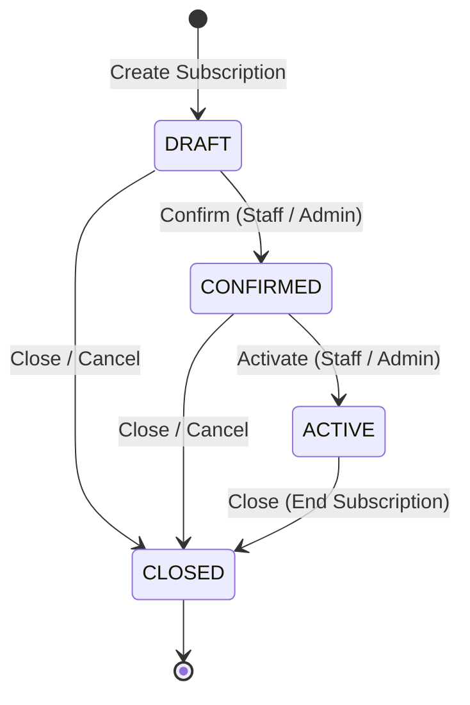

# Brightloop — Subscription Management & Pricing API Contract

**Module:** Member 3 – Subscription Management & Pricing  
**Base Path:** `/api/v1/subscriptions`  
**Version:** 1.0 (MVP)  
**Status:** Implemented & Documented

---

## 1. Overview

This document specifies the API contracts, data models, lifecycle state machine, pricing calculations, and integration points for the **Subscription Management & Pricing** module.

Member 4 (Billing, Invoices & Payments) and the Frontend use these contracts to create, manage, and bill recurring subscriptions.

---

## 2. Subscription Lifecycle State Machine



### Transition Rules

| Current Status | Target Status | Endpoint | Condition |
|---|---|---|---|
| `DRAFT` | `CONFIRMED` | `POST /:id/confirm` | At least 1 line item, meets plan minimum quantity |
| `CONFIRMED` | `ACTIVE` | `POST /:id/activate` | Validates `nextBillingDate` (initializes to `startDate` if unset) |
| `ACTIVE` | `CLOSED` | `POST /:id/close` | Terminates recurring billing eligibility |
| `DRAFT` | `CLOSED` | `POST /:id/close` | Cancels draft subscription |
| `CONFIRMED` | `CLOSED` | `POST /:id/close` | Cancels confirmed subscription |

- Any invalid transition (e.g., `DRAFT` &rarr; `ACTIVE`, `CLOSED` &rarr; `ACTIVE`) returns **HTTP 409 Conflict** with error code `INVALID_STATUS_TRANSITION`.
- All transitions record an immutable audit entry in `subscription_events`.

---

## 3. Financial & Pricing Calculation Rules

All calculations are performed on the backend using exact decimal arithmetic (Prisma `Decimal`).

### Formulae:

1. **Line Gross:**
   $$\text{Line Gross} = \text{Unit Price} \times \text{Quantity}$$
2. **Subtotal:**
   $$\text{Subtotal} = \sum \text{Line Gross}$$
3. **Discount Amount:**
   $$\text{Discount Amount} = \text{round}\left(\text{Subtotal} \times \frac{\text{Discount Percentage}}{100}, 2\right)$$
4. **Taxable Amount:**
   $$\text{Taxable Amount} = \text{Subtotal} - \text{Discount Amount}$$
5. **Tax Amount:**
   $$\text{Tax Amount} = \text{round}\left(\text{Taxable Amount} \times \frac{\text{Tax Rate Snapshot}}{100}, 2\right)$$
6. **Recurring Total:**
   $$\text{Recurring Total} = \text{Taxable Amount} + \text{Tax Amount}$$

### Price Snapshot Guarantee:
When a subscription is created, `unitPrice` and `descriptionSnapshot` are permanently frozen in `subscription_lines`. Future changes to product catalog prices do **not** affect existing subscriptions.

---

## 4. Endpoints

### 4.1 List Subscriptions
- **Method:** `GET`
- **Route:** `/api/v1/subscriptions`
- **Query Parameters:**
  - `status`: `DRAFT` | `CONFIRMED` | `ACTIVE` | `CLOSED` (optional)
  - `customerId`: UUID (optional)
  - `search`: string (optional, searches subscription number and customer name)
  - `page`: integer (default: 1)
  - `limit`: integer (default: 20, max: 100)
- **Response (200 OK):**
```json
{
  "success": true,
  "message": "Subscriptions retrieved successfully",
  "data": {
    "subscriptions": [
      {
        "id": "e6a2b842-83b5-492d-9442-5f6ffc1f0648",
        "subscriptionNumber": "SUB-202610-0001",
        "customerId": "8f8b89e2-6014-46d4-8d9e-1e94119fa901",
        "customer": {
          "id": "8f8b89e2-6014-46d4-8d9e-1e94119fa901",
          "name": "Acme Technologies Pvt Ltd",
          "email": "billing@acme.com"
        },
        "planId": "3b7f5d4e-28a1-432a-bc99-1a0a5585b9b1",
        "plan": {
          "id": "3b7f5d4e-28a1-432a-bc99-1a0a5585b9b1",
          "name": "Standard Monthly",
          "billingInterval": "MONTH",
          "intervalCount": 1
        },
        "status": "ACTIVE",
        "startDate": "2026-11-01T00:00:00.000Z",
        "nextBillingDate": "2026-11-01T00:00:00.000Z",
        "expiryDate": null,
        "paymentTermsDays": 15,
        "currency": "INR",
        "pricing": {
          "subtotal": "7680.00",
          "discountPercentage": "10.00",
          "discountAmount": "768.00",
          "taxRateSnapshot": "18.00",
          "taxAmount": "1244.16",
          "recurringTotal": "8156.16"
        },
        "itemCount": 2,
        "createdAt": "2026-10-31T12:00:00.000Z",
        "updatedAt": "2026-10-31T12:05:00.000Z"
      }
    ],
    "pagination": {
      "total": 1,
      "page": 1,
      "limit": 20,
      "totalPages": 1
    }
  }
}
```

---

### 4.2 Get Subscription Details
- **Method:** `GET`
- **Route:** `/api/v1/subscriptions/:id`
- **Response (200 OK):**
```json
{
  "success": true,
  "message": "Subscription details retrieved",
  "data": {
    "id": "e6a2b842-83b5-492d-9442-5f6ffc1f0648",
    "subscriptionNumber": "SUB-202610-0001",
    "customerId": "8f8b89e2-6014-46d4-8d9e-1e94119fa901",
    "customer": {
      "id": "8f8b89e2-6014-46d4-8d9e-1e94119fa901",
      "name": "Acme Technologies Pvt Ltd",
      "email": "billing@acme.com",
      "phone": "+91 9876543210",
      "billingAddress": "Bangalore, India"
    },
    "planId": "3b7f5d4e-28a1-432a-bc99-1a0a5585b9b1",
    "plan": {
      "id": "3b7f5d4e-28a1-432a-bc99-1a0a5585b9b1",
      "name": "Standard Monthly",
      "billingInterval": "MONTH",
      "intervalCount": 1,
      "minimumQuantity": 1
    },
    "status": "ACTIVE",
    "startDate": "2026-11-01T00:00:00.000Z",
    "nextBillingDate": "2026-11-01T00:00:00.000Z",
    "expiryDate": null,
    "paymentTermsDays": 15,
    "currency": "INR",
    "taxId": "c4d12345-aaaa-bbbb-cccc-111122223333",
    "taxRateSnapshot": "18.00",
    "discountId": "d5e67890-aaaa-bbbb-cccc-444455556666",
    "discountPercentage": "10.00",
    "lines": [
      {
        "id": "f1a2b3c4-1111-2222-3333-444455556666",
        "variantId": "aa11bb22-3333-4444-5555-666677778888",
        "descriptionSnapshot": "Cloud Storage - Pro 500GB",
        "quantity": 2,
        "unitPrice": "2500.00",
        "lineGross": "5000.00"
      },
      {
        "id": "f1a2b3c4-1111-2222-3333-777788889999",
        "variantId": "bb22cc33-4444-5555-6666-777788889999",
        "descriptionSnapshot": "Support Addon - 24/7 Dedicated",
        "quantity": 1,
        "unitPrice": "2680.00",
        "lineGross": "2680.00"
      }
    ],
    "pricing": {
      "subtotal": "7680.00",
      "discountPercentage": "10.00",
      "discountAmount": "768.00",
      "taxableAmount": "6912.00",
      "taxRateSnapshot": "18.00",
      "taxAmount": "1244.16",
      "recurringTotal": "8156.16"
    },
    "events": [
      {
        "id": "evt-1",
        "eventType": "SUBSCRIPTION_CREATED",
        "previousStatus": null,
        "newStatus": "DRAFT",
        "createdAt": "2026-10-31T12:00:00.000Z"
      },
      {
        "id": "evt-2",
        "eventType": "SUBSCRIPTION_CONFIRMED",
        "previousStatus": "DRAFT",
        "newStatus": "CONFIRMED",
        "createdAt": "2026-10-31T12:02:00.000Z"
      },
      {
        "id": "evt-3",
        "eventType": "SUBSCRIPTION_ACTIVATED",
        "previousStatus": "CONFIRMED",
        "newStatus": "ACTIVE",
        "createdAt": "2026-10-31T12:05:00.000Z"
      }
    ]
  }
}
```

---

### 4.3 Create Subscription
- **Method:** `POST`
- **Route:** `/api/v1/subscriptions`
- **Request Body:**
```json
{
  "customerId": "8f8b89e2-6014-46d4-8d9e-1e94119fa901",
  "planId": "3b7f5d4e-28a1-432a-bc99-1a0a5585b9b1",
  "startDate": "2026-11-01T00:00:00.000Z",
  "expiryDate": null,
  "paymentTermsDays": 15,
  "currency": "INR",
  "taxId": "c4d12345-aaaa-bbbb-cccc-111122223333",
  "discountId": "d5e67890-aaaa-bbbb-cccc-444455556666",
  "lines": [
    {
      "variantId": "aa11bb22-3333-4444-5555-666677778888",
      "quantity": 2,
      "customUnitPrice": 2500.00
    },
    {
      "variantId": "bb22cc33-4444-5555-6666-777788889999",
      "quantity": 1
    }
  ]
}
```
- **Validation:**
  - `customerId`: UUID required.
  - `planId`: UUID required.
  - `lines`: array with at least 1 item; each with `variantId` (UUID) and `quantity` (`>= 1`).
  - Total quantity must satisfy `plan.minimumQuantity`.
- **Response:** `201 Created` with created Subscription object in `DRAFT` status.

---

### 4.4 Lifecycle Actions

#### Confirm Subscription
- **Method:** `POST`
- **Route:** `/api/v1/subscriptions/:id/confirm`
- **Transitions:** `DRAFT` &rarr; `CONFIRMED`

#### Activate Subscription
- **Method:** `POST`
- **Route:** `/api/v1/subscriptions/:id/activate`
- **Transitions:** `CONFIRMED` &rarr; `ACTIVE`
- **Behavior:** Marks subscription active and confirms `nextBillingDate`.

#### Close Subscription
- **Method:** `POST`
- **Route:** `/api/v1/subscriptions/:id/close`
- **Transitions:** `DRAFT` | `CONFIRMED` | `ACTIVE` &rarr; `CLOSED`
- **Request Body (optional):**
```json
{
  "reason": "Customer requested cancellation"
}
```

---

### 4.5 Calculate Pricing Preview
- **Method:** `POST`
- **Route:** `/api/v1/subscriptions/calculate-pricing`
- **Request Body:**
```json
{
  "lines": [
    { "variantId": "aa11bb22-3333-4444-5555-666677778888", "quantity": 2, "customUnitPrice": 2500 }
  ],
  "taxId": "c4d12345-aaaa-bbbb-cccc-111122223333",
  "discountId": "d5e67890-aaaa-bbbb-cccc-444455556666"
}
```
- **Response (200 OK):**
```json
{
  "success": true,
  "data": {
    "subtotal": "5000.00",
    "discountPercentage": "10.00",
    "discountAmount": "500.00",
    "taxableAmount": "4500.00",
    "taxRate": "18.00",
    "taxAmount": "810.00",
    "recurringTotal": "5310.00"
  }
}
```

---

### 4.6 Catalog Preview (Independent Development Helper)
- **Method:** `GET`
- **Route:** `/api/v1/subscriptions/catalog-preview`
- **Purpose:** Supplies available customers, plans, products/variants, taxes, and discounts for frontend subscription creation without hardcoding. Queries DB first, and falls back to designated dev fixtures when other modules have not seeded data yet.

---

## 5. Member 4 Integration Interface (Billing Run Contract)

### Query Due Subscriptions
- **Method:** `GET`
- **Route:** `/api/v1/subscriptions/for-billing`
- **Query Parameter:** `dueBefore` (ISO timestamp, e.g. `2026-11-01T23:59:59.999Z`)
- **Filters:** Only subscriptions with `status = 'ACTIVE'` and `nextBillingDate <= dueBefore`.
- **Response (200 OK):**
```json
{
  "success": true,
  "data": [
    {
      "id": "e6a2b842-83b5-492d-9442-5f6ffc1f0648",
      "subscriptionNumber": "SUB-202610-0001",
      "customerId": "8f8b89e2-6014-46d4-8d9e-1e94119fa901",
      "customer": { "id": "...", "name": "...", "email": "..." },
      "plan": { "billingInterval": "MONTH", "intervalCount": 1 },
      "nextBillingDate": "2026-11-01T00:00:00.000Z",
      "paymentTermsDays": 15,
      "currency": "INR",
      "taxRateSnapshot": "18.00",
      "discountPercentage": "10.00",
      "lines": [
        {
          "variantId": "...",
          "descriptionSnapshot": "...",
          "quantity": 2,
          "unitPrice": "2500.00"
        }
      ]
    }
  ]
}
```
After Member 4 generates the invoice, Member 4 updates `nextBillingDate` using the plan interval or calls the helper method.

